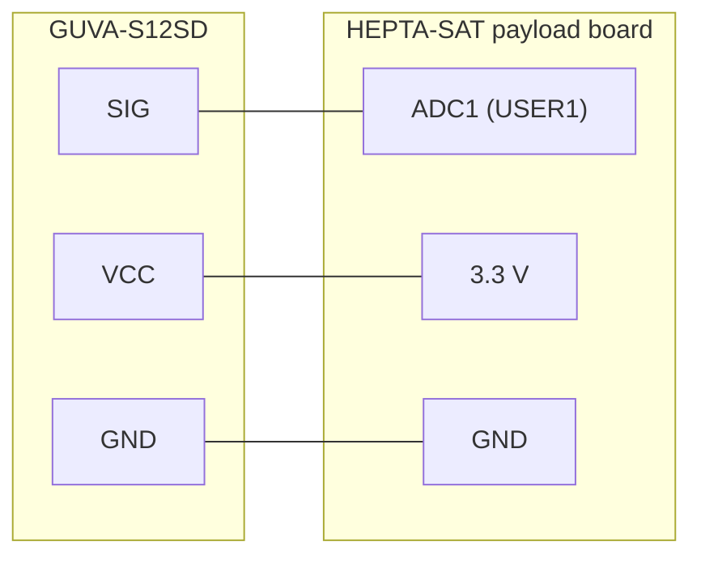

# Lab7-sample_uv-sensor

HEPTA-SAT training sample: **Grove UV Sensor** (**GUVA-S12SD**).

## Sensor Specifications

| Item | Value |
|------|-------|
| Module | **Seeed Grove UV Sensor** |
| Sensor element | **GUVA-S12SD** (UV photodiode) |
| Interface | Analog output → **USER1 / USER2 / USER3** (V4.1.1) |
| Supply | 3.3 V |
| Wavelength sensitivity | approx. 240 to 370 nm (module spec) |
| Conversion | Illuminance [mW/m²] = `307.0 × voltage [V]` |
| UV index | `illuminance / 200` (uses 16-sample averaged voltage) |

## Wiring (HEPTA-SAT V4.1.1)

| Sensor | HEPTA-SAT |
|--------|-----------|
| SIG (analog output) | **ADC1** (`USER1` in the sketch) |
| VCC | 3.3 V payload (`eps.switch_3V3_on()`) |
| GND | GND |

The sketch uses `uv.begin(USER1)`. For a different connection, use `USER2` for **ADC2** or `USER3` for **ADC3**.



## Build and Upload

1. Open `Lab7-sample_uv-sensor.ino` in the Arduino IDE
2. Board: **Generic RP2350**
3. Check out the `src/` submodule (`git submodule update --init`)
4. Compile and upload
5. Serial monitor at **9600 baud**

## Example Serial Output

```
GUVA-S12SD ready
Voltage: 0.206 [V]
UV illumination: 63.2 [mW/m2]
UV index: 0.32
Voltage: 0.413 [V]
UV illumination: 126.8 [mW/m2]
UV index: 0.63
```

## Driver

- Board interface: `HeptaUvGuvaS12sd` from `src/HeptaSat.h`
- `src/drv/uv_guva_s12sd.h` / `.cpp`
- Details: `src/docs/drivers/uv-guva-s12sd.md`
